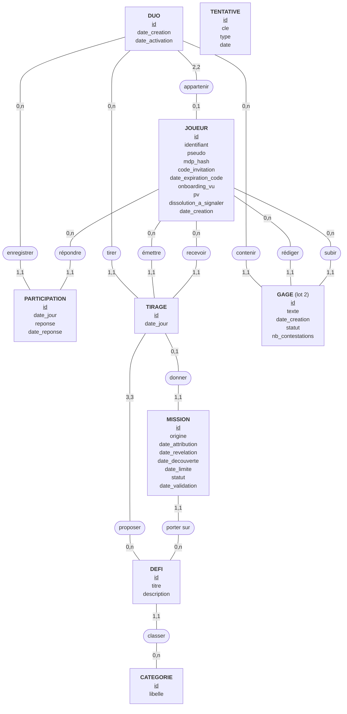
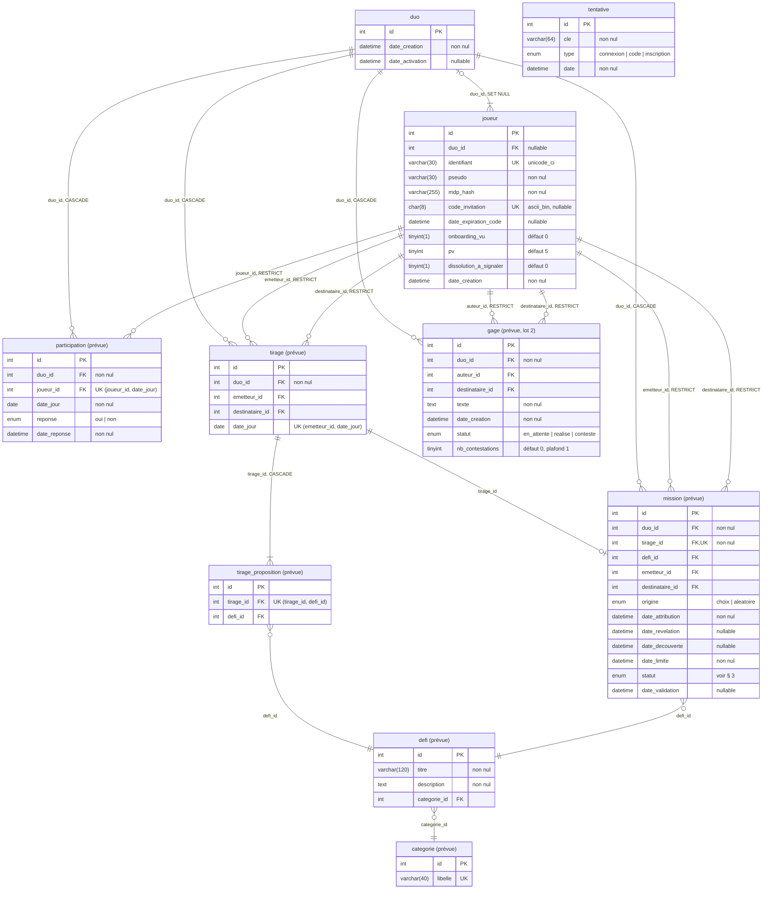

# Quest & Love — Modèle de données

> **Statut : à valider en S8**, avec un enseignant, avant toute implémentation. Annexe de [`doc-technique.md`](doc-technique.md).
> Référence : cadrage unifié V2.15, § 7. **En cas d'écart, le cadrage fait foi.**
> Ce document décrit ; le SQL exécutable vit dans `sql/schema.sql`.
> Conventions : moteur InnoDB, jeu de caractères `utf8mb4`, clés primaires entières auto-incrémentées, noms en français sans accent, dates en `Europe/Paris`.
>
> **Version 1.6 — 12 novembre 2026.** Diagramme et § 2 alignés sur `sql/schema.sql` : retrait de `evenement` et de `joueur.debut_cycle` (sans source dans le cadrage), ajout de `joueur.dissolution_a_signaler`, du type `inscription` de `tentative`, et des `duo_id` portant la cascade (§ 6) ; index `tirage` fusionné dans son unicité (§ 5). Normalisation : retrait de `tirage.date_choix` et de `tirage_proposition.choisi`, que `mission.tirage_id` rend redondants (cadrage V2.16). Ajout du MCD et du MLD (§ 1).
> Version 1.5 du 6 novembre 2026 : ajout de `joueur.onboarding_vu` et de `duo.date_activation` pour l'onboarding de B2 (cadrage § 8.5) : l'accès à C1 exige les deux colonnes `onboarding_vu` à 1, et « duo formé après 12 h » se calcule sur `date_activation` (cadrage § 4.2).
> Version 1.4 du 6 novembre 2026 : le code d'invitation et son échéance passent de `duo` à `joueur` ; la ligne `duo` n'est créée qu'à la formation et porte toujours deux joueurs ([ADR-0002](../docs/adr/0002-code-invitation-dans-joueur.md)). Longueur et alphabet du code tranchés (§ 7).
> Version 1.3 du 15 octobre 2026 : identifiant de connexion unique séparé du pseudo affiché, libre (cadrage § 6.6).
> Version 1.2 du 14 octobre 2026 : unicité du pseudo sans tenir compte des majuscules ; le tableau préliminaire du cadrage § 7 utilise désormais lui aussi `joueur` et `duo`.
> Version 1.1 du 9 octobre 2026 : tables renommées selon le glossaire (`utilisateur` devient `joueur`, `couple` devient `duo`). Version 1.0 du 18 septembre 2026.

## 1. Vue d'ensemble

- **Comptes et duo** — `joueur`, `duo`
- **Rythme quotidien** — `participation`, `tirage`, `tirage_proposition`
- **Contenu** — `categorie`, `defi`
- **Jeu** — `mission`, `gage` _(lot 2)_
- **Technique** — `tentative`

Relations :

- un `duo` porte exactement deux `joueur` ; un `joueur` appartient à zéro ou un `duo` ;
- un `tirage` porte exactement trois `tirage_proposition` ;
- une `mission` naît d'un `tirage` choisi ou d'une attribution aléatoire, et pointe un `defi`.

Trois niveaux, du métier au SQL : MCD (règles de gestion, Merise), MLD (tables et clés, forme textuelle), MPD (types et règles MySQL, diagramme).

### MCD

Entités en rectangle, identifiant souligné ; associations en ovale ; cardinalités `min,max` côté entité. Aucune clé étrangère à ce niveau.



- `proposer` est la seule association n-n : elle devient la table `tirage_proposition` au MLD.
- `TENTATIVE` n'est liée à rien : technique, elle compte des essais par clé hachée, pas par joueur.

### MLD

Clé primaire soulignée, clé étrangère précédée de `#`.

- DUO (<ins>id</ins>, date_creation, date_activation)
- JOUEUR (<ins>id</ins>, identifiant, pseudo, mdp_hash, code_invitation, date_expiration_code, onboarding_vu, pv, dissolution_a_signaler, date_creation, #duo_id)
- PARTICIPATION (<ins>id</ins>, date_jour, reponse, date_reponse, #duo_id, #joueur_id)
- CATEGORIE (<ins>id</ins>, libelle)
- DEFI (<ins>id</ins>, titre, description, #categorie_id)
- TIRAGE (<ins>id</ins>, date_jour, #duo_id, #emetteur_id, #destinataire_id)
- TIRAGE_PROPOSITION (<ins>#tirage_id, #defi_id</ins>)
- MISSION (<ins>id</ins>, origine, date_attribution, date_revelation, date_decouverte, date_limite, statut, date_validation, #tirage_id, #defi_id)
- GAGE (<ins>id</ins>, texte, date_creation, statut, nb_contestations, #duo_id, #auteur_id, #destinataire_id)
- TENTATIVE (<ins>id</ins>, cle, type, date)

`#emetteur_id`, `#destinataire_id` et `#auteur_id` pointent `JOUEUR` ; un même `JOUEUR` est ainsi relié deux fois à `TIRAGE` et à `GAGE`, une fois par rôle.

Écarts voulus du MPD par rapport au MLD :

- `tirage_proposition` reçoit un `id` technique ; le couple `(tirage_id, defi_id)` reste unique (§ 4).
- `mission` recopie `duo_id`, `emetteur_id` et `destinataire_id` de son tirage : `duo_id` porte la cascade de la dissolution (§ 6), `destinataire_id` et `emetteur_id` servent les index du rattrapage et de l'accueil (§ 5) sans jointure.

### Diagramme (MPD)

Tiré du § 2. « prévue » : table absente de `sql/schema.sql`. Entiers non signés partout ; libellé d'un lien : colonne, règle de suppression. Lecture de haut en bas : table référencée au-dessus, table qui porte la clé étrangère (`FK`, placée juste après `PK`) en dessous ; une table de liaison se lit entre ses deux tables.



## 2. Tables

### `joueur`

| Champ | Type | Contrainte |
|---|---|---|
| `id` | entier non signé | clé primaire |
| `identifiant` | chaîne 30 | unique sans tenir compte des majuscules ni des accents (interclassement `utf8mb4_unicode_ci`), non nul ; format : cadrage § 6.6 |
| `pseudo` | chaîne 30 | non nul, non unique ; format : cadrage § 6.6 |
| `mdp_hash` | chaîne 255 | non nul, produit par `password_hash` |
| `code_invitation` | chaîne 8, ASCII sensible à la casse | unique, nullable : nul tant qu'aucun code n'est généré et une fois le duo formé |
| `date_expiration_code` | date-heure | nullable, génération + 60 minutes |
| `duo_id` | entier non signé | nullable, clé étrangère vers `duo`, suppression du duo = remise à nul |
| `onboarding_vu` | booléen | non nul, défaut 0 ; mis à 1 quand le joueur termine ou passe l'onboarding ; remis à 0 pour les deux joueurs à la formation d'un duo |
| `pv` | entier très court non signé | non nul, défaut 5 |
| `dissolution_a_signaler` | booléen | non nul, défaut 0 ; mis à 1 sur le partenaire seul quand l'autre dissout le duo ; lu par D3, qui le remet à 0 |
| `date_creation` | date-heure | non nul |

- `duo_id` nul signifie « sans duo » : c'est ce champ qui aiguille vers B1 ; avec un duo, `onboarding_vu` des deux joueurs aiguille vers B2 ou C1 (doc technique § 3.6).
- La régénération écrase le code et repousse l'échéance : c'est ce qui invalide l'ancien. Un code expiré ou nul est régénéré au chargement de B1.
- Aucune autre donnée personnelle : minimisation, cadrage § 10.

### `duo`

| Champ | Type | Contrainte |
|---|---|---|
| `id` | entier non signé | clé primaire |
| `date_creation` | date-heure | non nul |
| `date_activation` | date-heure | nullable : nulle à la formation, posée avec `$maintenant` quand les deux joueurs ont `onboarding_vu` à 1 ; instant de référence de « duo formé après 12 h » |

- Créé en une transaction, quand le deuxième joueur saisit un code valide : il porte aussitôt ses deux joueurs.
- Le code et son échéance ne sont pas ici : un joueur en attente n'a pas de `duo`, ce qui garde `joueur.duo_id` nul comme seule définition de « sans duo ».

### `participation`

| Champ | Type | Contrainte |
|---|---|---|
| `id` | entier non signé | clé primaire |
| `duo_id` | entier non signé | non nul, clé étrangère vers `duo`, suppression en cascade |
| `joueur_id` | entier non signé | clé étrangère vers `joueur` |
| `date_jour` | date | non nul |
| `reponse` | énumération `oui` / `non` | non nul |
| `date_reponse` | date-heure | non nul |

### `categorie` et `defi`

| Table | Champ | Type | Contrainte |
|---|---|---|---|
| `categorie` | `id` | entier non signé | clé primaire |
| `categorie` | `libelle` | chaîne 40 | unique |
| `defi` | `id` | entier non signé | clé primaire |
| `defi` | `titre` | chaîne 120 | non nul |
| `defi` | `description` | texte | non nul |
| `defi` | `categorie_id` | entier non signé | clé étrangère vers `categorie` |

- Données de référence, chargées par `sql/defis.sql`. Aucune écriture depuis l'application en lot 1, aucune suppression jamais.

### `tirage` et `tirage_proposition`

| Table | Champ | Type | Contrainte |
|---|---|---|---|
| `tirage` | `id` | entier non signé | clé primaire |
| `tirage` | `duo_id` | entier non signé | non nul, clé étrangère vers `duo`, suppression en cascade |
| `tirage` | `date_jour` | date | non nul |
| `tirage` | `emetteur_id` | entier non signé | clé étrangère vers `joueur` |
| `tirage` | `destinataire_id` | entier non signé | clé étrangère vers `joueur` |
| `tirage_proposition` | `id` | entier non signé | clé primaire |
| `tirage_proposition` | `tirage_id` | entier non signé | clé étrangère vers `tirage`, suppression en cascade |
| `tirage_proposition` | `defi_id` | entier non signé | clé étrangère vers `defi` |

- Le choix n'est pas stocké ici : c'est la `mission` qui pointe ce `tirage` (`mission.tirage_id`). Proposition retenue : celle dont le `defi_id` est celui de la mission ; instant du choix : `mission.date_attribution`. Une seule source, aucune copie à tenir d'accord.
- Tirage sans mission : choix pas encore fait. Mission d'origine `aleatoire` : joueur passif à la bascule de midi.
- Propositions non choisies (exclues 3 jours, cadrage § 4.6) : celles du tirage dont le `defi_id` diffère de celui de sa mission.

### `mission`

| Champ | Type | Contrainte |
|---|---|---|
| `id` | entier non signé | clé primaire |
| `duo_id` | entier non signé | non nul, clé étrangère vers `duo`, suppression en cascade |
| `tirage_id` | entier non signé | non nul, unique, clé étrangère vers `tirage` : le tirage dont le défi est issu |
| `defi_id` | entier non signé | clé étrangère vers `defi` |
| `emetteur_id` | entier non signé | clé étrangère vers `joueur` |
| `destinataire_id` | entier non signé | clé étrangère vers `joueur` |
| `origine` | énumération `choix` / `aleatoire` | non nul |
| `date_attribution` | date-heure | non nul |
| `date_revelation` | date-heure | nullable |
| `date_decouverte` | date-heure | nullable |
| `date_limite` | date-heure | non nul, minuit du jour d'attribution |
| `statut` | énumération, voir § 3 | non nul |
| `date_validation` | date-heure | nullable |

- `date_decouverte` nulle à l'expiration déclenche la variante « jamais découvert » de D1.

### `gage` _(lot 2)_

| Champ | Type | Contrainte |
|---|---|---|
| `id` | entier non signé | clé primaire |
| `duo_id` | entier non signé | non nul, clé étrangère vers `duo`, suppression en cascade |
| `auteur_id` | entier non signé | clé étrangère vers `joueur` |
| `destinataire_id` | entier non signé | clé étrangère vers `joueur` |
| `texte` | texte | non nul, échappé à l'affichage |
| `date_creation` | date-heure | non nul |
| `statut` | énumération `en_attente` / `realise` / `conteste` | non nul |
| `nb_contestations` | entier très court non signé | non nul, défaut 0, plafond 1 |

### `tentative`

| Champ | Type | Contrainte |
|---|---|---|
| `id` | entier non signé | clé primaire |
| `cle` | chaîne 64 | non nul ; connexion : identifiant saisi ; code : numéro du joueur ; tous types : empreinte SHA-256 de la session et de l'adresse IP, jamais en clair |
| `type` | énumération `connexion` / `code` / `inscription` | non nul ; inscription : clé IP seule |
| `date` | date-heure | non nul |

- Purge des lignes de plus de 30 minutes (15 de fenêtre + 15 d'attente) à chaque essai, par `LimiteTentativesService` : la table ne peut pas enfler.

## 3. Cycle de vie d'une mission

```
attribue_non_revele → en_cours → valide → acquis
                         │          │
                         ▼          ▼
                      expire     conteste
```

| Départ | Arrivée | Déclencheur | Effet |
|---|---|---|---|
| — | `attribue_non_revele` | choix de l'émetteur, ou attribution aléatoire à midi | création de la mission |
| `attribue_non_revele` | `en_cours` | les deux ont choisi, ou il est midi | `date_revelation` renseignée |
| `en_cours` | `valide` | déclaration du destinataire, après confirmation | `date_validation` renseignée |
| `en_cours` | `expire` | minuit passé, au rattrapage | perte de point de vie |
| `valide` | `acquis` | 24 h après validation _(lot 2)_ | définitif |
| `valide` | `conteste` | contestation de l'émetteur _(lot 2)_ | perte de point de vie |

- Toute transition vérifie le statut de départ avant d'écrire : protection contre la double validation depuis deux appareils.
- En lot 1, `acquis` et `conteste` ne sont jamais atteints ; l'énumération les prévoit pour éviter une migration.

## 4. Contraintes critiques

Posées **en base**, pas seulement vérifiées en PHP. Ce sont elles qui rendent l'application correcte sur deux appareils simultanés — scénario normal de la soutenance, cadrage § 6.7.

| Contrainte | Table | Ce qu'elle empêche |
|---|---|---|
| Unicité `(joueur_id, date_jour)` | `participation` | Deux réponses contradictoires, et le double clic |
| Unicité `(emetteur_id, date_jour)` | `tirage` | Un second tirage obtenu par rechargement, et la double attribution aléatoire |
| Unicité `(tirage_id, defi_id)` | `tirage_proposition` | Un doublon parmi les trois propositions |

## 5. Index

Au-delà des clés primaires et étrangères :

- `mission` sur `(destinataire_id, statut, date_limite)` — requête du rattrapage, la plus fréquente de l'application.
- `mission` sur `(emetteur_id, date_attribution)` — accueil et historique.
- `tirage` : aucun index en plus. L'unicité du § 4 est déclarée `(emetteur_id, date_jour)`, `emetteur_id` en tête : elle sert aussi à la lecture des propositions du jour et à la clé étrangère `emetteur_id`.
- `tentative` sur `(cle, type, date)` — comptage des dernières minutes.
- `joueur` sur `duo_id`.

## 6. Suppressions

Règles : cadrage § 10. Aucune corbeille, aucune conservation différée.

| Action | Supprimé | Conservé |
|---|---|---|
| Dissolution du duo | `mission`, `tirage`, `tirage_proposition`, `participation`, `gage` du duo, puis la ligne `duo` | Les deux `joueur`, remis à `duo_id` nul et 5 points de vie |
| Suppression de compte | Tout ce qui précède, plus la ligne `joueur` | Rien |

- Les clés étrangères des tables de jeu sont déclarées en suppression en cascade depuis `duo` : la dissolution est une seule instruction, pas une séquence à maintenir.

### Dissolution : ce que F2 livre et ce qui reste à faire avec les tables de jeu

F2 (`AppairageService::dissoudre`) livre avant les tables de jeu. Dans une seule transaction, sous verrou des deux lignes `joueur` : les deux joueurs repassent à `pv = 5`, `onboarding_vu = 0` et `duo_id` nul ; le partenaire reçoit `dissolution_a_signaler = 1` (lu par D3, qui remet la colonne à 0) ; puis `DELETE FROM duo`. Aucune ligne de jeu n'existe encore, la cascade n'a donc rien à supprimer. Décisions closes, à ne pas rouvrir. À faire quand les tables de jeu sont créées :

- [ ] **Cascade** : `mission`, `tirage`, `participation` et `gage` portent un `duo_id` avec `ON DELETE CASCADE` vers `duo`. `tirage_proposition` suit `tirage` par la même cascade. Aucune clé étrangère vers `joueur` ne doit bloquer le `DELETE FROM duo` : les joueurs ne sont pas supprimés à la dissolution. Un oubli de cascade échoue franchement (erreur de clé étrangère à la suppression), il ne laisse pas de données orphelines en silence. `DuoDepot::supprimer` reste une seule instruction et ne change pas.
- [ ] **`sql/schema.sql`** : les tables de jeu sont supprimées avant `joueur` et `duo` (ordre des `DROP`).
- [ ] **Test** : ajouter à `tests/AppairageServiceTest.php` un cas qui crée des lignes de chaque table de jeu pour deux duos, dissout l'un et vérifie que seules les lignes du duo dissous disparaissent.
- [ ] **F3** : `SupprimerCompteControleur` appelle `dissoudre` avant de supprimer la ligne `joueur` (cadrage § 10), sans réécrire la suppression des données de jeu.
- Code d'invitation : rien à faire. `code_invitation` est déjà nul depuis la formation du duo ; B1 en génère un nouveau à son prochain affichage (cadrage § 7).
- `tentative` n'est pas une donnée de jeu : la dissolution n'y touche pas.

## 7. À trancher en S8

- [x] Longueur et alphabet du code d'invitation — 8 caractères parmi 32 : A à Z sans I ni O, 2 à 9 (tranché le 06/11).
- [ ] Longueur maximale d'un titre et d'une description de défi, une fois les 15 premiers défis écrits (S5).
- [ ] Longueur maximale d'un gage.
- [x] Purge des `tentative` — à chaque essai, lignes de plus de 30 minutes (tranché par A3 et B1).
- [ ] Conservation ou non de l'historique des missions après dissolution — actuellement supprimé.
