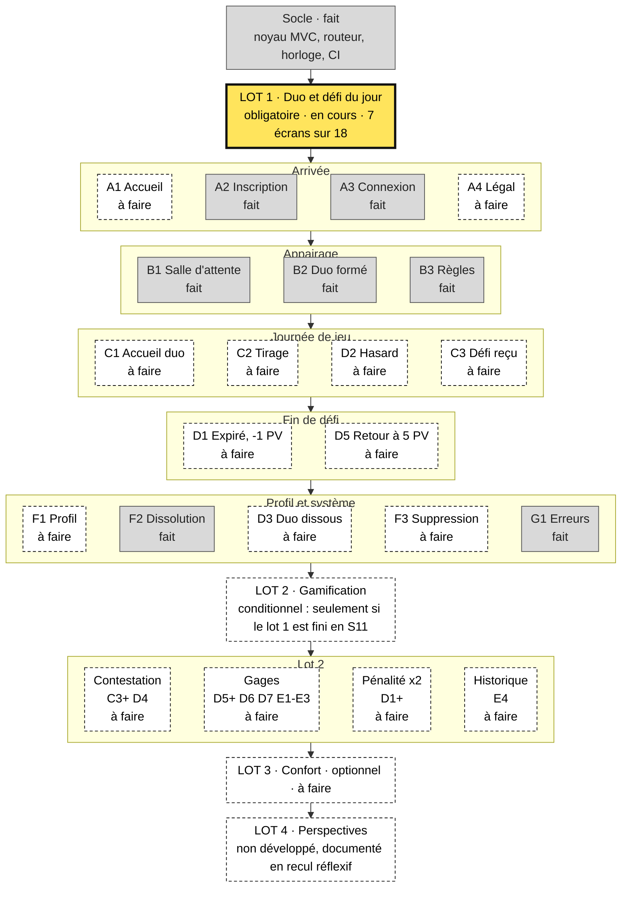

# Quest & Love

Application web qui transforme le quotidien d'un couple en jeu : défi du jour tiré au sort, attribué au partenaire, points de vie, gages.

**Binôme :** Sheyrel, Matteo — Master 2
**Document de référence :** [`01-cadrage/cadrage-unifie.md`](01-cadrage/cadrage-unifie.md) (V2.10, 14/10/2026). En cas d'écart entre deux documents, le cadrage fait foi.

## Feuille de route

État du **code** au 06/11/2026. Le périmètre de chaque lot est arrêté dans le [cadrage § 11](01-cadrage/cadrage-unifie.md) ; le calendrier semaine par semaine est au § 12 et fait foi. Les maquettes du lot 1 sont toutes zonées (28 cadres sur 28) : ce qui reste à faire est le code.

Lecture : case grise = fait ; case jaune au trait épais = en cours ; case blanche en pointillés = à faire. Le statut est aussi écrit dans le texte de la case.

Repli sans diagramme (même contenu) :

| Lot | Statut | Écrans faits | Écrans à faire |
|---|---|---|---|
| Socle | Fait | Noyau MVC, routeur, horloge, garde-fous CI | — |
| 1 — Duo et défi du jour | En cours, 7 sur 18 | A2, A3, B1, B2, B3, F2, G1 | A1, A4, C1, C2, C3, D1, D2, D3, D5, F1, F3 |
| 2 — Gamification | Conditionnel | — | C3+, D1+, D4, D5+, D6, D7, E1, E2, E3, E4 |
| 3 — Confort | À faire | — | Catégories, statistiques (F4), changement de mot de passe et de pseudo (F5), avatars |
| 4 — Perspectives | Non développé | — | Défis personnalisés, preuve photo, courriel, web push, récupération de compte |

### Jalons hors code

| Jalon | Échéance | Statut |
|---|---|---|
| Validation de la conception fonctionnelle | 07/10 | Fait |
| Maquettes du lot 1 (Figma, 28 cadres) | S5 | Fait |
| Feuille de style (`base.css`, `composants.css`, `ecrans.css`) | S6 | À confirmer : absente du dépôt |
| Schéma de la base validé à l'oral | S8, 09–15/11 | À faire |
| Couple témoin recruté | S9, 16–22/11 | À confirmer |
| Lot 1 fonctionnel de bout en bout | S11, 30/11–06/12 | À faire |
| Gel du code, audit d'accessibilité, vidéo et sauvegarde Azrael | 13/12 | À faire |
| Rendu du dossier | 16/12 | À faire |
| Soutenance | 18/12 | À faire |

Mise à jour : à la main, dans la même PR que le ticket (`Closes #N`).
<!-- TODO(simplif): statuts écrits à la main, à automatiser s'ils dérivent du code -->

## Où trouver quoi

| Dossier | Contenu |
|---|---|
| [`01-cadrage/`](01-cadrage/) | Cadrage unifié (source de vérité), documentation fonctionnelle, Lean Canvas |
| [`02-recherche-utilisateur/`](02-recherche-utilisateur/) | Proto-personas, parcours utilisateur, guide d'animation du focus group |
| [`03-conception/`](03-conception/) | Inventaire des écrans, carte de navigation (maquettes et parcours : Figma, voir ressources externes) |
| [`04-technique/`](04-technique/) | Description technique, modèle de données |
| [`docs/`](docs/) | Décisions d'architecture (`adr/`), guide GitHub Issues, consignes pour les outils de développement (`agents/`) |
| [`GLOSSARY.md`](GLOSSARY.md) | Vocabulaire du domaine : un mot par concept, pour la documentation et le code |
| `00-donnees-sensibles/` | **Local, non versionné** (RGPD) : enregistrements, questionnaires bruts, consentements. Absent du dépôt : chaque membre le crée sur son poste. |
| `00-supports-cours/` | **Local, non versionné** : supports fournis par les enseignants (diffusion restreinte), dont l'exemple de documentation fonctionnelle. |
| [`99-archives/`](99-archives/) | Versions périmées, conservées pour l'historique (wireframes et parcours antérieurs à la V2.9, ancien audit de conformité) |

### Détail des documents

| Document | Rôle | Statut |
|---|---|---|
| `01-cadrage/cadrage-unifie.md` | Cahier des charges. Toute règle est arrêtée ici **avant** d'être codée. | V2.10 (14/10/2026) — règles des comptes, vocabulaire du glossaire, rétroplanning indicatif et checkpoints |
| `01-cadrage/doc-fonctionnelle.md` | Documentation fonctionnelle : écrans, règles, lots. | V1.1 (14/10/2026) — codes d'écrans dans les lots, gestion du temps au lot 1 |
| `01-cadrage/remarques-jury.md` | Suivi des remarques de l'encadrant et du jury : source, statut, réponse ; questions de soutenance anticipées. | V1.1 (14/10/2026) — aucune remarque bloquante |
| `01-cadrage/lean-canvas.json` | Cadrage stratégique : problème, utilisateurs, hypothèses. | Encadrés 7 et 8 à compléter |
| `02-recherche-utilisateur/proto-personas.*` | Sylvianne (initiatrice) et Joul (invité sceptique). | À confirmer par la recherche utilisateur |
| `02-recherche-utilisateur/parcours-utilisateur.*` | Customer journey map : découverte → fidélisation. | À jour |
| `02-recherche-utilisateur/guide-animation-focus-group.md` | Déroulé et questions du focus group (2 h, 6 à 8 participants). | v0.3 (07/10/2026) — exercice, séance non tenue |
| `03-conception/inventaire-ecrans.md` | Liste des écrans et avancement du zonage Figma. | v2.2 — lot 1 complet (28/28 cadres) |
| `04-technique/doc-technique.md` | Description technique : architecture MVC, mécanismes, interface, manifeste des fichiers par lot, exploitation. Spécification écrite avant le code. | V1.2 (14/10/2026) — horloge et simulation du temps, méthode des bases, tests, déconnexion en `POST` |
| `04-technique/modele-donnees.md` | Annexe : tables, contraintes, index, cycle de vie d'une mission. | V1.3 (15/10/2026) — tables `joueur` et `duo`, identifiant de connexion unique séparé du pseudo affiché · **à valider en S8** |

Les fichiers `.json` sont les fichiers de travail générés par l'outil de conception ; les `.md` du même nom en sont la version lisible. Les deux se modifient ensemble.

## Ressources externes

- Fichier Figma de zonage (maquettes du lot 1, 28 cadres) : https://www.figma.com/design/2e82ZImnpQvYrNbE04DlRB/Quest---Love-%E2%80%94-Wireframes--zonage-?node-id=1-2
- Parcours 1 — arrivée et appairage (FigJam) : https://www.figma.com/board/NDb4YHNxJ62zUXGGJ9a3Vn/Quest---Love---Parcours-1-_-arriv%C3%A9e-et-appairage--v3-?node-id=0-1
- Parcours 2 — journée de jeu (FigJam) : https://www.figma.com/board/vBm24iEeigI92RZ99AyWxM/Quest---Love---Parcours-2-_-journ%C3%A9e-de-jeu--v3-
- Parcours 3 — fin de défi et événements (FigJam) : https://www.figma.com/board/UHsyf9H1fFEcpqHKkIm49F/Quest---Love---Parcours-3-_-fin-de-d%C3%A9fi-et-%C3%A9v%C3%A9nements--v3-
- Application déployée : https://azrael.sha.univ-poitiers.fr/~mlorenzi/
- Code source : https://azrael.sha.univ-poitiers.fr/~mlorenzi/debug.php

## Outillage IA

Déclaration d'usage : le binôme se sert de Claude Code comme assistant. Chaque ligne de code est relue et doit pouvoir être expliquée par l'un ou l'autre membre (ADR-0001) ; les consignes données à l'outil sont dans [`CLAUDE.md`](CLAUDE.md) et [`AGENTS.md`](AGENTS.md).

| Outil | Rôle | Installation |
|---|---|---|
| Ponytail (plugin) | Pousse vers le changement le plus petit, sans toucher aux couches MVC ; audit (`/ponytail-audit`) et registre des raccourcis (`/ponytail-debt TODO(simplif)`) | proposé à l'ouverture du projet (`.claude/settings.json`) |
| claude-code-setup (plugin) | Recommandations de configuration de Claude Code, appliquées seulement après accord | idem |
| Graphify (CLI Python) | Graphe local du code (analyse syntaxique, aucun envoi à un LLM ni au cloud) | `winget install --id=astral-sh.uv -e`, puis `uv tool install graphifyy` |

Graphe : `graphify extract . --code-only` (résultat dans `graphify-out/`, non versionné).

## Environnement local

| Outil | Rôle | Installation |
|---|---|---|
| WAMP, PHP 8.2, MySQL | Faire tourner l'application et `sql/reinitialiser.php` | `bash scripts/installer-wamp.sh` dans Git Bash (doc technique § 6.3) |
| GitHub CLI (`gh`) | Tickets et PR depuis le terminal | `winget install --id GitHub.cli`, puis `gh auth login` |
| Garde-fous | Refus des commits attribués à un outil d'IA | `git config core.hooksPath .githooks`, une fois par clone |

Vérifications mécaniques du code, aussi lancées par la CI à chaque PR : `bash scripts/verifier.sh`. Après une installation, relancer VS Code pour qu'il voie le nouveau PATH.

## Convention de nommage

- Noms de fichiers en minuscules, mots séparés par des tirets, **sans accent ni espace** (les accents cassent l'encodage entre systèmes ; ils restent obligatoires dans le contenu des documents).
- Contenu en français. Exceptions tolérées : termes métier sans équivalent (`lean-canvas`, `lo-fi`).
- Numérotation des dossiers (`01-`, `02-`…) pour forcer l'ordre de lecture. `99-` est réservé aux archives.
- Pas de date dans le nom des documents vivants : git en assure le suivi. Date obligatoire en préfixe `AAAA-MM-JJ_` dès qu'un fichier part dans `99-archives/`.
- Version suffixée `-vNN` uniquement sur un document figé. Jamais `final`, `final2`, `vraiment-final`.
